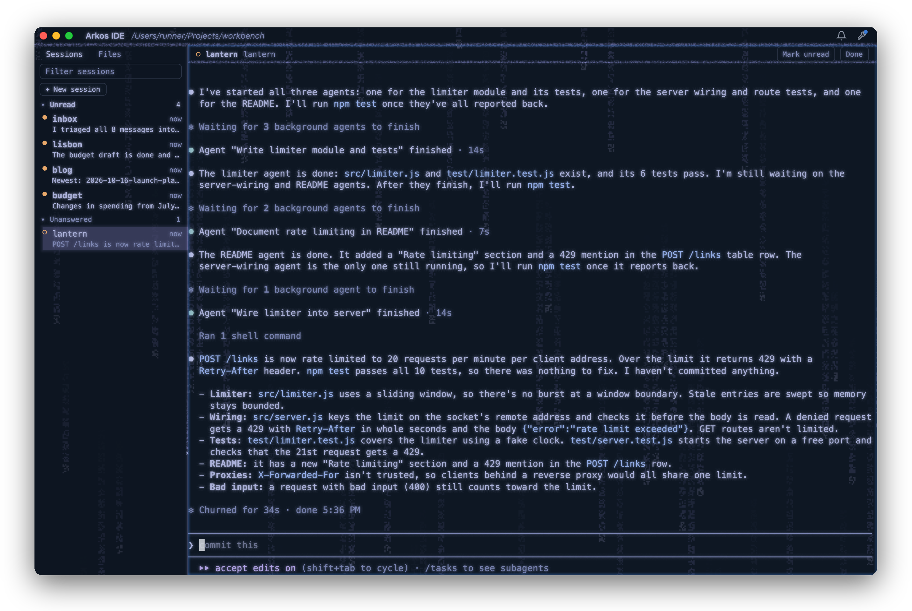
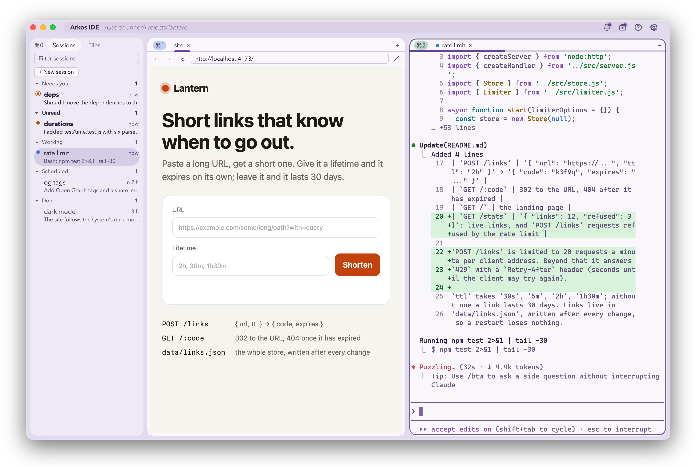
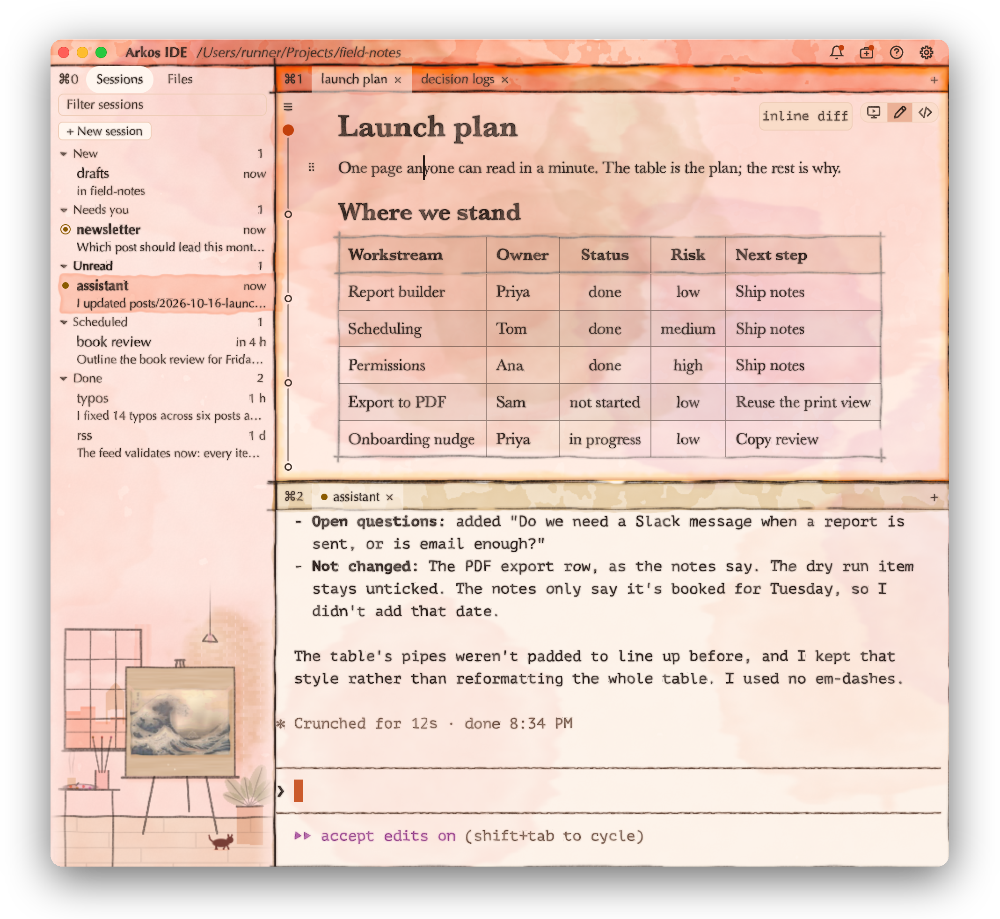
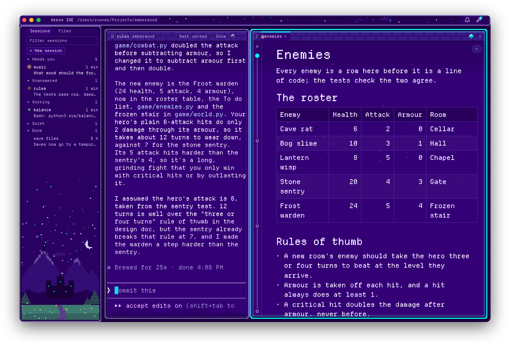
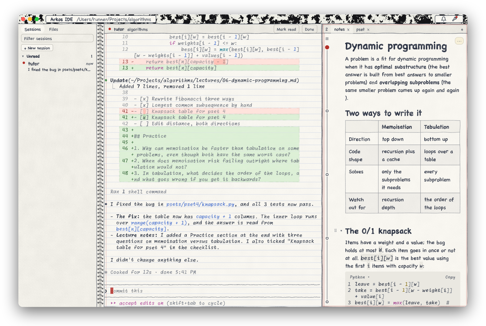
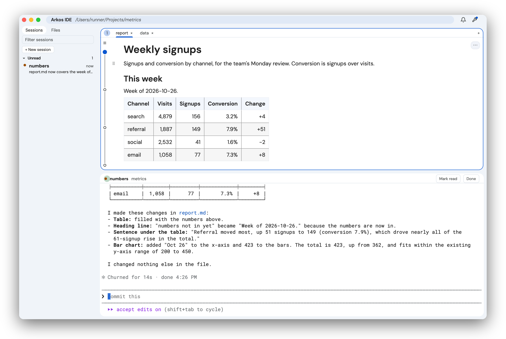
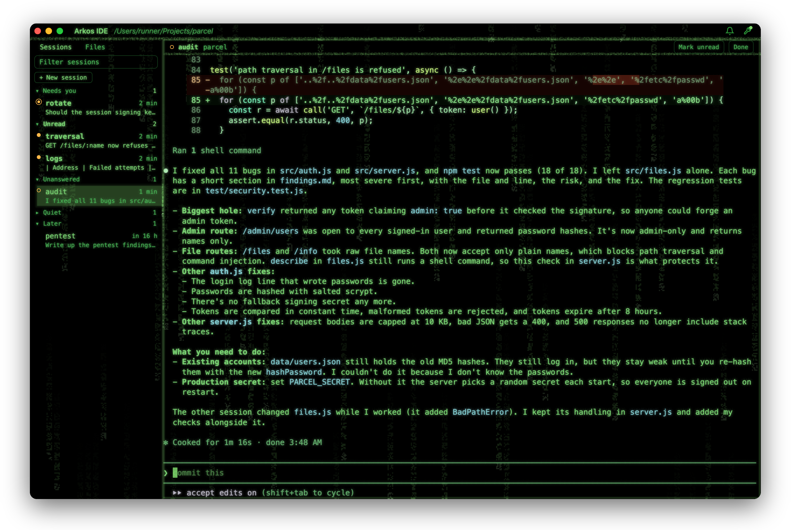

<h1 align="center">Arkos IDE</h1>

<p align="center">Run many Claude Code sessions side by side, and never lose one.</p>

<picture>
  
</picture>

Arkos keeps track of where each of your Claude Code sessions stands, so with many running at
once you always know which one to look at next. They sit in one list, grouped by what they need
from you: Needing your input → Still at work → Quiet or done.

- **Durable:** sessions keep running through a frozen window or an update, and come back with
  their conversations after a restart, a shutdown or a macOS update.
- **Customizable:** ten distinct themes, some of them animated, and layouts you arrange by drag
  and drop: split a session, move any pane or tab, and start more Claude Code sessions in it.
- **All in one place:** a file browser, web pages and an editor for the documents Claude writes
  sit beside your sessions.
- **Reminders:** for a session you need to come back to tomorrow, or check on once a day,
  schedule it for any date and time down to the minute, once or every day, weekday or week; it
  waits under Scheduled and comes back as unread when it is due.

Built for Apple silicon, macOS 14 or later.

## Install

```sh
# Or install through brew
brew trust --cask csarkosh/tap/arkos-ide
brew install --cask csarkosh/tap/arkos-ide
```

## Who it's for

Seven ways people use it, each shot in one of the ten built-in themes. Every picture is a real
session, taken by [`scripts/shoot.sh`](docs/development.md#screenshots).

**The multi tasker** runs Claude Code on unrelated work at once: a rate limiter, an inbox and a
trip, each with its own subagents. The Inbox lists every session by what it needs: a question
first, then the answers not yet read, then the ones at work. Shot in Tokyo Rain, and in Navy, the theme Arkos starts in.

<picture>
  
</picture>

**The web developer** keeps a feature branch in a worktree, with Claude Code on it and the app's
page in a web tab beside the code. Shot in Lavender Material.

<picture>
  
</picture>

**The blogger** lives in markdown: a launch plan rendered in the editor, and Claude Code beside it
bringing the plan up to date. Shot in Peach Watercolor and Lavender Watercolor, which wash the
window in pigment and ink.

<picture>
  
</picture>

**The indie game dev** builds a dungeon crawl: Claude Code fixes the combat rule a test caught and
designs the next room's enemy. Shot in Timo Purple, a pixel-art night, and Arabia Solar, the same
world by day.

<picture>
  
</picture>

**The student** keeps a course in one folder: the lecture notes on the left, and Claude Code on
the right explaining why the problem set failed. Shot in Composition Notebook, its terminal text
written in by hand.

<picture>
  
</picture>

**The data analyst** owns the weekly numbers: Claude Code runs the script, and the signups report
fills in, chart and all. Shot in Material.

<picture>
  
</picture>

**The hacker** has Claude Code audit a file-drop service and harden its sign-in, while a second
session reads the ssh log for the intruder. Shot in Matrix, with rune rain behind the panes.

<picture>
  
</picture>

## Privacy

Arkos can send anonymous usage reports and crash reports. Usage reports stay on your Mac until
you turn them on (Settings > Privacy, or `arkos telemetry on`). A crash report is sent only when
you press Send in the dialog that shows it, or when you have chosen Always. Once a day the update
check goes through the project's own server so installs can be counted, with nothing that
identifies you or your Mac. [What Arkos sends](docs/telemetry.md) lists every key.

## Learn more

- **[The guide](docs/guide.md)**: sessions and recovery, the sidebar, the markdown editor, the
  browser pane, the video pane, keys, settings and updates.
- **[Themes](docs/themes.md)**: the ten built in, and how to make your own.
- **Agents**: run `arkos guide` in an Arkos terminal for how to show the user a video or a
  document and how to change the theme and settings.
- **[Developing](docs/development.md)**: building from source, tests, releases and status.

[ Buy me tokens](https://donate.csarko.sh/arkos)

## License

GPL-3.0. Modified versions must be released under the same license. See [LICENSE](LICENSE).
