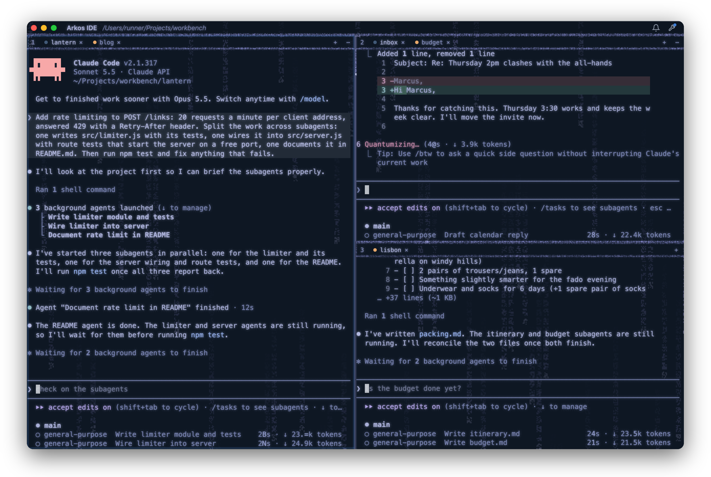
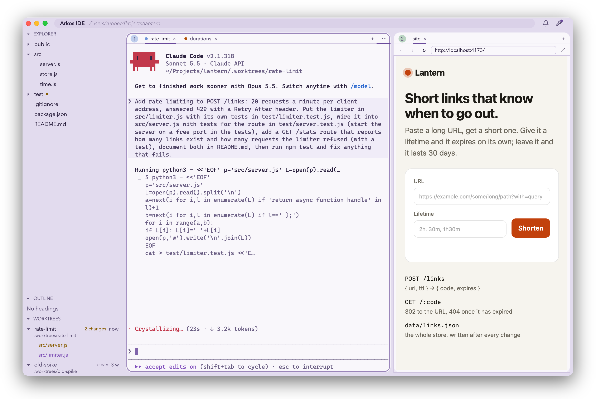
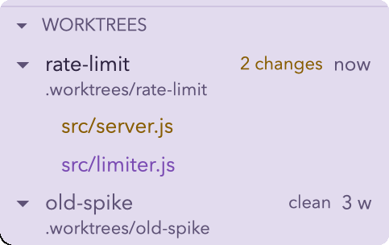
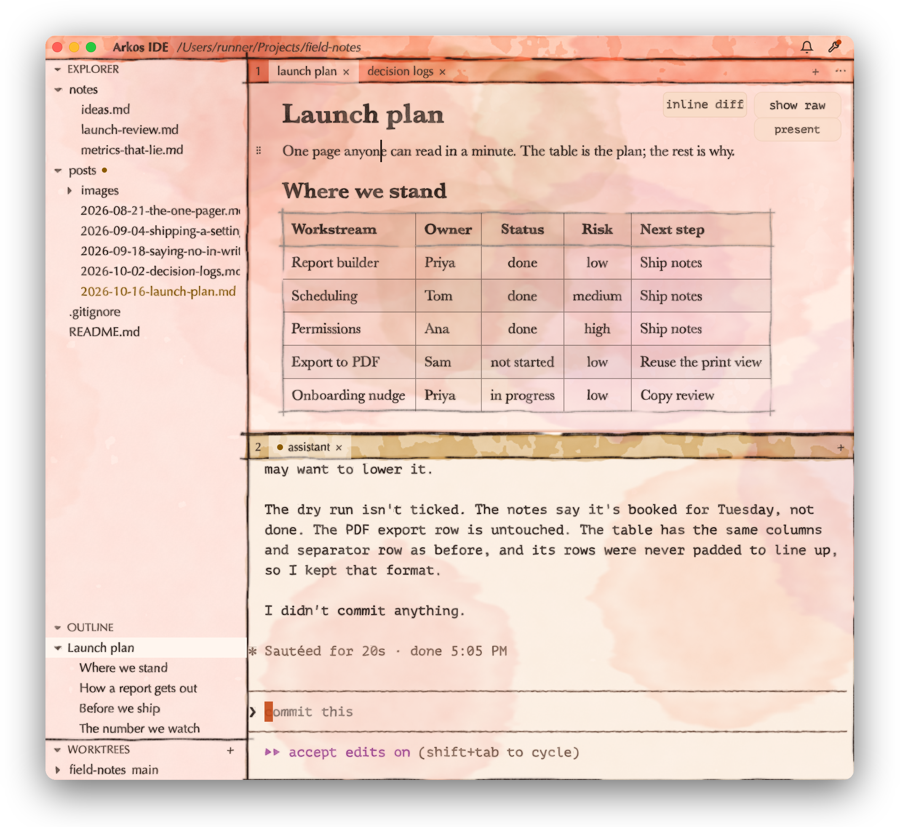
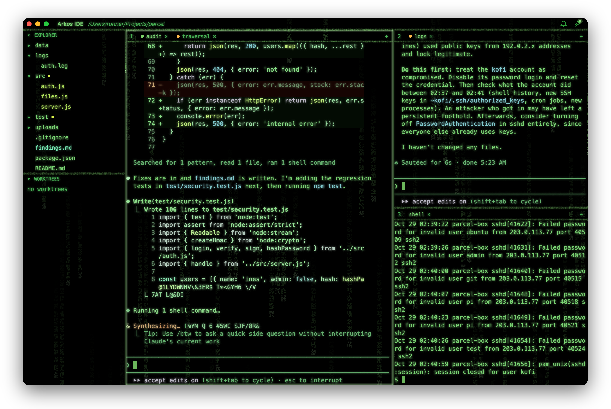
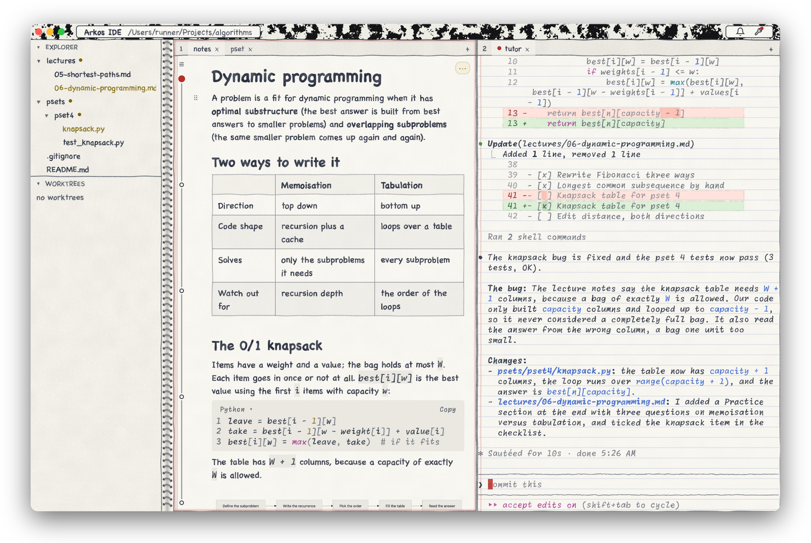
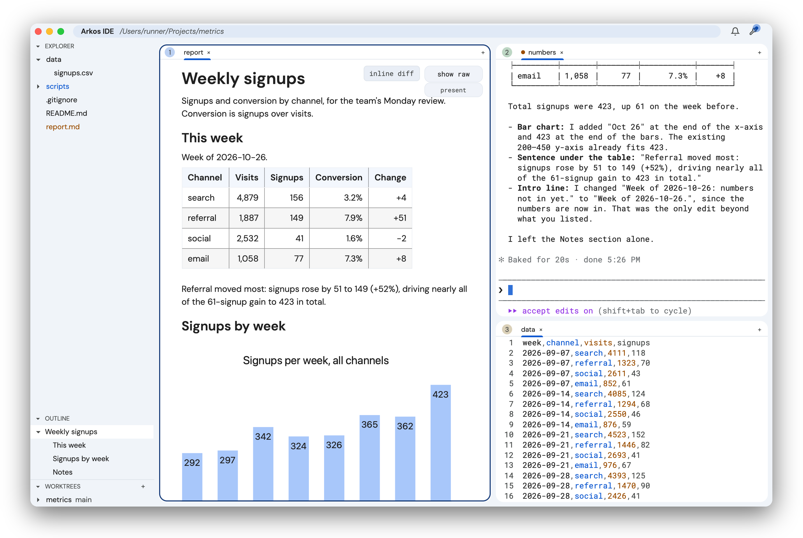
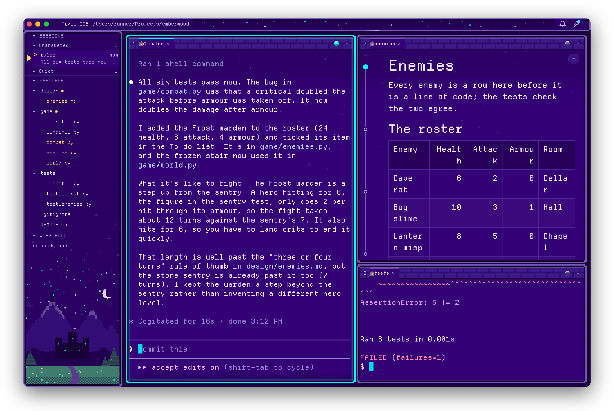

<h1 align="center">Arkos IDE</h1>

<p align="center">Run many Claude Code sessions side by side, and never lose one.</p>

<picture>
  
</picture>

<p align="center">
<b>Panes and tabs</b> for your sessions · <b>a daemon</b> that keeps them alive · <b>a web pane</b> · <b>a file tree</b> and <b>a live worktree list</b> across every repo · <b>a markdown editor</b> · <b>a CSV and spreadsheet grid</b> · <b>a video pane</b>
</p>

Arkos is a terminal layout manager built for Claude Code: a grid of terminal panes with tabs
that say which session is working and which is waiting on you, a web page in a pane beside the
code, a file tree, a live list of every repository's worktrees with how long each has sat
untouched, and a markdown editor for the documents the sessions write. Every session lives in a separate daemon, so a frozen window, an
update or a restart never loses work: the window comes back and every tab is where you left
it, with Claude Code resumed. Written in Rust with GPUI, it stays light on memory and scrolls
smoothly with dozens of sessions open.

Built for Apple silicon, macOS 14 or later.

## Install

```sh
brew install --cask csarkosh/tap/arkos-ide
```

Homebrew 6 and later install from a tap like this one only once you trust it, and the full name
above trusts the cask. If you ran `brew tap csarkosh/tap` first, or use a command with the short
name, and Homebrew answers `Refusing to load cask csarkosh/tap/arkos-ide from untrusted tap
csarkosh/tap`, run `brew trust --cask csarkosh/tap/arkos-ide` and try again.

Releases are signed with a Developer ID and notarized, so the download opens as any app does,
and from then on the app updates itself (see [Updating](docs/guide.md#updating)). Run "Install Claude Code hooks" from
the command palette once, and the tabs follow what each session is doing.

## Who it's for

Six ways people use it, each in one of the built-in themes (tokyo-rain, lavender-material,
peach-watercolor, matrix, composition-notebook, material); every picture is a real session, taken
by [`scripts/shoot.sh`](docs/development.md#screenshots).

**The multi tasker** runs several Claude Code sessions on unrelated workstreams at once and
orchestrates the agents that orchestrate the subagents: here a rate limiter for a web service,
an inbox being triaged and a trip being planned, each with its own background agents, and
behind two of them a blog and a household budget whose sessions have finished. The tabs say
which session is working and which is waiting on you.

<picture>
  
</picture>

**The web developer** keeps a feature branch in a worktree, Claude Code on it and on the main
checkout, and the app's page in a web tab next to the code; the file tree shows what changed, and
the Worktrees list shows each side worktree with how long since anything in it changed, so a
stale one stands out; Claude finds those with `arkos worktrees --stale 7d` and prunes them once
you agree. It is shot in Lavender Material: lavender's colours as near-white cards on a
lavender frame, each pane's number on a chip of its own colour and its active tab underlined.

<picture>
  
</picture>

Close up, the Worktrees list: the side worktrees of every repository under the open folder,
newest change first, each with how long since any of its files changed; a spike untouched for
three weeks reads dimmer.

<picture>
  
</picture>

**The blogger** lives in markdown: a launch plan rendered in the editor, with its status table
as a grid, a Mermaid diagram, a checklist and a folded open-questions section, and a Claude Code
session beside it bringing the plan up to date from the review notes.

The same work stacked, one pane above the other: the file on top with the caret in it, since
the rendered view is also where you edit, and the session below. It is shot in Peach Watercolor,
whose watercolor effect washes the window in the theme's pigments, inks the outlines of the panes
and the table, and draws the text as if in ink; Lavender Watercolor is the same effect in lilac.

<picture>
  
</picture>

**The hacker** works on security: Claude Code audits a small file-drop service and hardens its
sign-in, each fix with a regression test, while a second session fixes the path traversal it is
known to have, a third reads the server's ssh log for the address that guessed its way in, and a
shell shows the end of that log. It is shot in Matrix, black with soft phosphor green, whose
effect runs rune rain behind the panes, lights the text with a green glow, and scrambles each
new line for a moment before it settles, as on the audit's status line here.

<picture>
  
</picture>

**The student** keeps a course in one folder: the week's lecture notes rendered on the left,
with a problem set's code in the next tab, and Claude Code on the right, having explained as a
classmate would why the problem set's tests failed, fixing the code and adding practice questions
to the notes, which grow on the left as it writes. It is shot in Composition Notebook: a marbled
cover over the title bar, ruled cream pages bound to the file tree by a wire spiral, and terminal
text written in by hand.

<picture>
  
</picture>

**The data analyst** owns the weekly numbers: the signups report rendered on the left, this
week's table filled in, a week added to its bar chart and a line on what moved most, all from the
script Claude Code wrote and ran on the right, with the raw export below it. It is shot in Material: white cards on a cool
frame, each pane's number on a chip of its own colour, the active tab underlined in blue.

<picture>
  
</picture>

**The indie game dev** builds a small dungeon crawl: Claude Code on the left fixes the combat rule
a failing test caught and designs the next room's enemy, in the design table first and then in
the code, while the design notes on the right gain the new row as it is written and a shell
below them shows the failing test that started it. It is shot in Timo Purple, whose overworld effect frames each pane
like a game's menu window on a night ground, makes each tab bar a stone ledge and the title bar a
strip of sky, stands a castle at the foot of the file tree, sets the window in a pixel face and types terminal
text in like dialogue. Arabia Solar is the same effect by day: a desert palace with domes and minarets among palms and dunes, in sand and cream under a sun.

<picture>
  
</picture>

## Privacy

Arkos can send anonymous usage reports and crash reports. Usage reports stay on your Mac until
you turn them on (Settings > Privacy, or `arkos telemetry on`). A crash report is sent only when
you press Send in the dialog that shows it, or when you have chosen Always. Once a day the update
check goes through the project's own server so installs can be counted, with nothing that
identifies you or your Mac. [What Arkos sends](docs/telemetry.md) lists every key.

## Learn more

- **[The guide](docs/guide.md)**: sessions and recovery, the sidebar, the markdown editor, the
  browser pane, the video pane, keys, settings and updates.
- **[Themes](docs/themes.md)**: the ten built in, and how to make your own.
- **Agents**: run `arkos guide` in an Arkos terminal for how to show the user a video or a
  document and how to change the theme and settings.
- **[Developing](docs/development.md)**: building from source, tests, releases and status.

[ Buy me tokens](https://donate.csarko.sh/arkos)

## License

GPL-3.0. Modified versions must be released under the same license. See [LICENSE](LICENSE).
