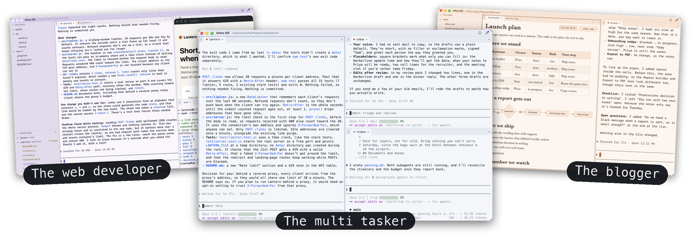
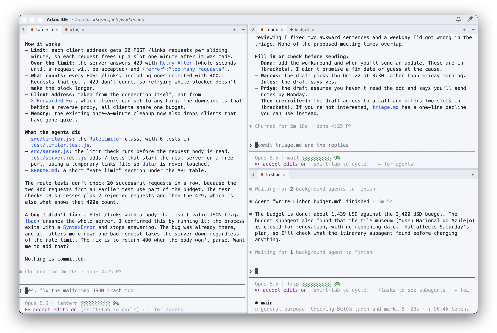
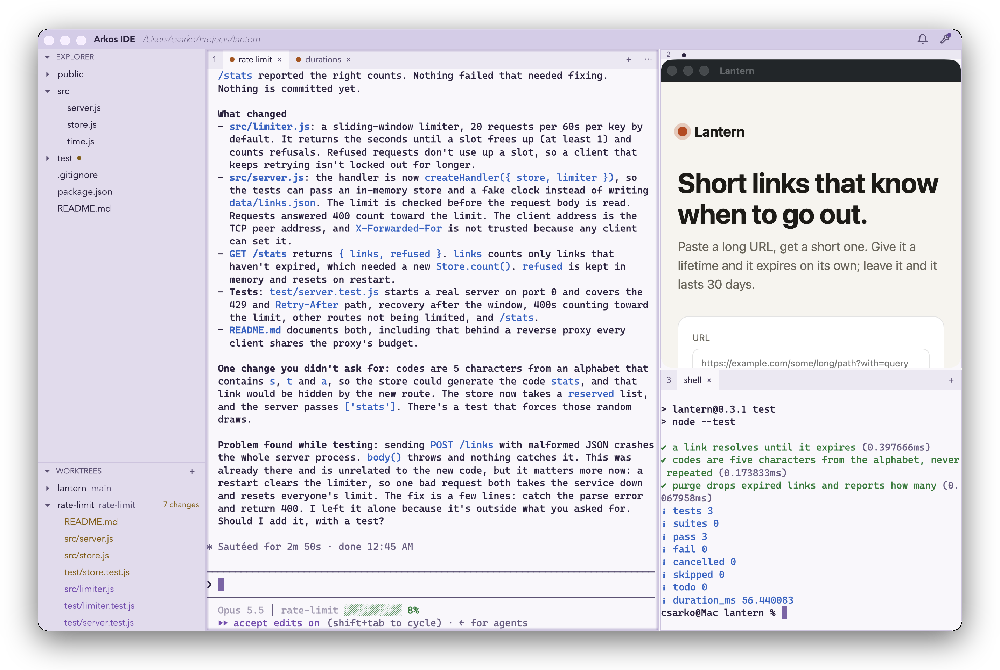
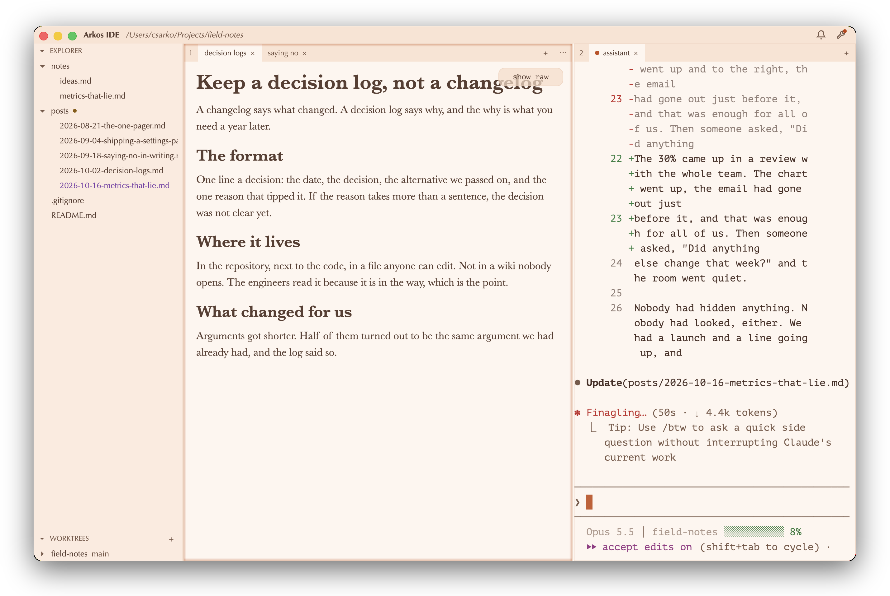

<h1 align="center">Arkos IDE</h1>

<p align="center">Run many Claude Code sessions side by side, and never lose one.</p>

<picture>
  <source media="(prefers-color-scheme: dark)" srcset="docs/images/hero-dark.png">
  
</picture>

<p align="center">
<b>Panes and tabs</b> for your sessions · <b>a daemon</b> that keeps them alive · <b>a docked Chrome pane</b> · <b>a file tree</b> with git worktrees · <b>a markdown editor</b>
</p>

Arkos is a terminal layout manager built for Claude Code: a grid of terminal panes with tabs
that say which session is working and which is waiting on you, a Chrome window docked into a
pane beside the code, a file tree and git worktree explorer, and a markdown editor for the
documents the sessions write. Every session lives in a separate daemon, so a frozen window, an
update or a restart never loses work: the window comes back and every tab is where you left
it, with Claude Code resumed. Written in Rust with GPUI, it stays light on memory and scrolls
smoothly with dozens of sessions open.

Built for Apple silicon, macOS 14 or later.

## Install

```sh
brew install --cask csarkosh/tap/arkos-ide
```

Releases are signed with a Developer ID and notarized, so the download opens as any app does,
and from then on the app updates itself (see [Updating](docs/guide.md#updating)). Run "Install Claude Code hooks" from
the command palette once, and the tabs follow what each session is doing.

## Who it's for

Three ways people use it, each in one of the built-in themes (navy, lavender-light,
peach-light); every picture is a real session, taken by [`scripts/shoot.sh`](docs/development.md#screenshots).

**The multi tasker** runs several Claude Code sessions on unrelated workstreams at once and
orchestrates the agents that orchestrate the subagents: here a rate limiter for a web service,
an inbox being triaged, and a trip being planned, three windows' worth of work in one, with the
tabs saying which session is working and which is waiting on you.

<picture>
  <source media="(prefers-color-scheme: dark)" srcset="docs/images/multitasker-dark.png">
  
</picture>

**The web developer** keeps a feature branch in a worktree, Claude Code on it and on the main
checkout, the app's page docked in Chrome next to the code, and the tests in a shell; the file
tree and the worktree list show what changed.

<picture>
  <source media="(prefers-color-scheme: dark)" srcset="docs/images/web-developer-dark.png">
  
</picture>

**The blogger** is not an engineer: a folder of posts in the file tree, two of them open in the
markdown editor, and a Claude Code session drafting the next one from the notes.

<picture>
  <source media="(prefers-color-scheme: dark)" srcset="docs/images/blogger-dark.png">
  
</picture>

## Privacy

Arkos can send anonymous usage reports and crash reports. Both are off until you turn them on,
in Settings (Privacy) or with `arkos telemetry on`. Once a day the update check goes through the
project's own server so installs can be counted, with nothing that identifies you or your Mac.
[What Arkos sends](docs/telemetry.md) lists every key.

## Learn more

- **[The guide](docs/guide.md)**: sessions and recovery, the sidebar, the markdown editor, the
  browser pane, keys, settings and updates.
- **[Themes](docs/themes.md)**: the five built in, and how to make your own.
- **Agents**: run `arkos guide` in an Arkos terminal for how to change the theme and settings.
- **[Developing](docs/development.md)**: building from source, tests, releases and status.

## License

GPL-3.0. Modified versions must be released under the same license. See [LICENSE](LICENSE).
