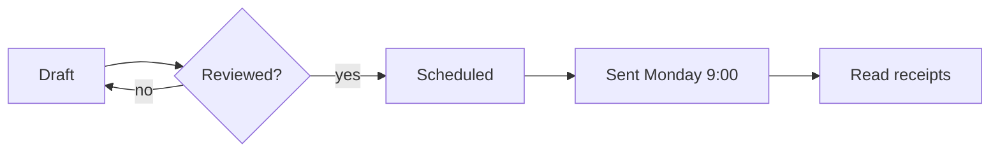
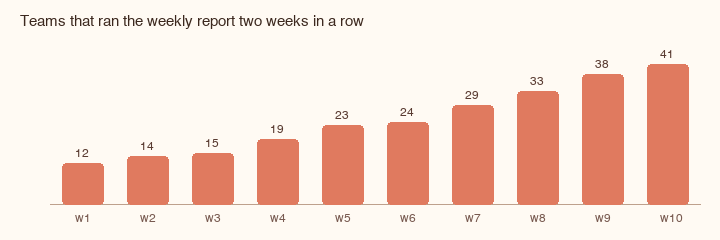

# Launch plan

One page anyone can read in a minute. The table is the plan; the rest is why.

## Where we stand

| Workstream | Owner | Status | Risk | Next step |
|:-----------|:------|:------:|:----:|:----------|
| Report builder | Priya | done | low | Ship notes |
| Scheduling | Tom | in review | medium | One send a week |
| Permissions | Ana | in progress | high | Decide external sharing |
| Export to PDF | Sam | not started | low | Reuse the print view |
| Onboarding nudge | Priya | blocked | high | After permissions |

## How a report gets out



## Before we ship

- [x] Decide the sending time with support
- [x] Remove the banner that inflated weekly actives
- [ ] Permissions decision in writing
- [ ] Dry run with two real teams

<details>
<summary>Open questions</summary>

- Do we send on public holidays, or the next working day?
- Who owns the report when its author leaves the team?
- Is a PDF export a launch item or a week-two item?

</details>

## The number we watch



Boring, and climbing. The `report_runs` event is one line in the tracker:

```js
track("report_runs", { team, week, streak });
```
