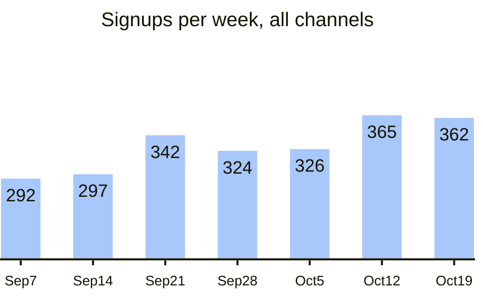

# Weekly signups

Signups and conversion by channel, for the team's Monday review. Conversion is signups over
visits.

## This week

Week of 2026-10-26: numbers not in yet.

| Channel | Visits | Signups | Conversion | Change |
|:--|--:|--:|--:|--:|
| search | | | | |
| referral | | | | |
| social | | | | |
| email | | | | |

## Signups by week

## Notes

- Referral has climbed since the invite link moved into the share menu.
- Social visits are flat; the paid test ended on 2026-09-28.
