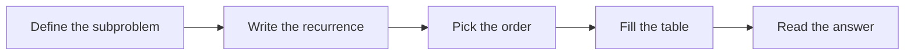

# Dynamic programming

A problem is a fit for dynamic programming when it has **optimal substructure** (the best
answer is built from best answers to smaller problems) and **overlapping subproblems** (the
same smaller problem comes up again and again).

## Two ways to write it

| | Memoisation | Tabulation |
|:--|:--|:--|
| Direction | top down | bottom up |
| Code shape | recursion plus a cache | loops over a table |
| Solves | only the subproblems it needs | every subproblem |
| Watch out for | recursion depth | the order of the loops |

## The 0/1 knapsack

Items have a weight and a value; the bag holds at most `W`. Each item goes in once or not
at all. `best[i][w]` is the best value using the first `i` items with capacity `w`:

```python
leave = best[i - 1][w]
take = best[i - 1][w - weight[i]] + value[i]
best[i][w] = max(leave, take)  # if it fits
```

The table has `W + 1` columns, because a capacity of exactly `W` is allowed.



## Before the midterm

- [x] Rewrite Fibonacci three ways
- [x] Longest common subsequence by hand
- [ ] Knapsack table for pset 4
- [ ] Edit distance, both directions
